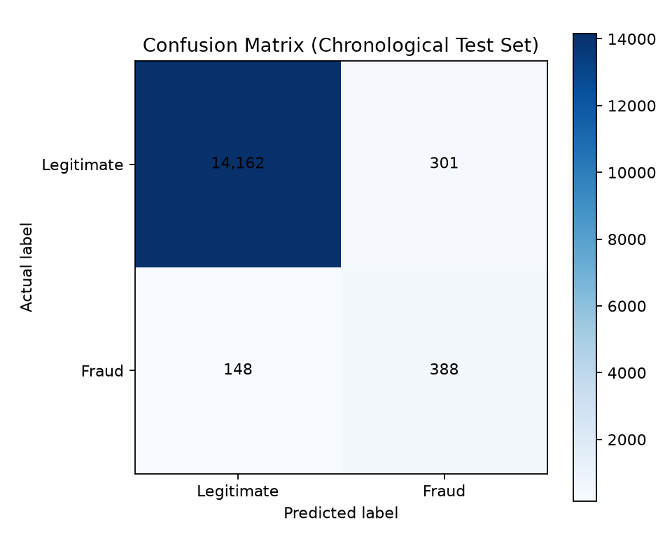
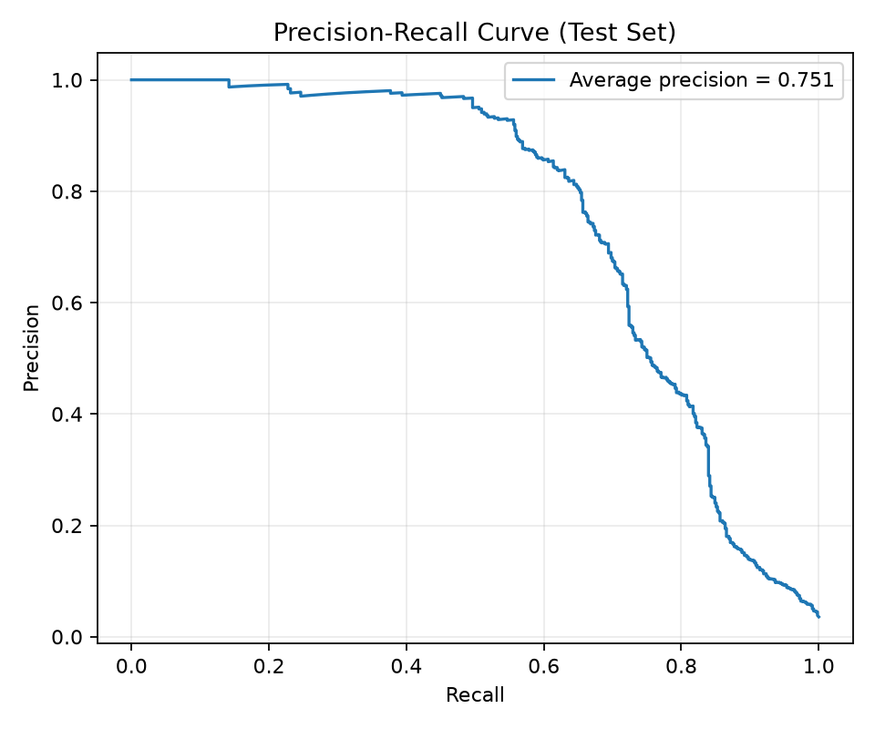
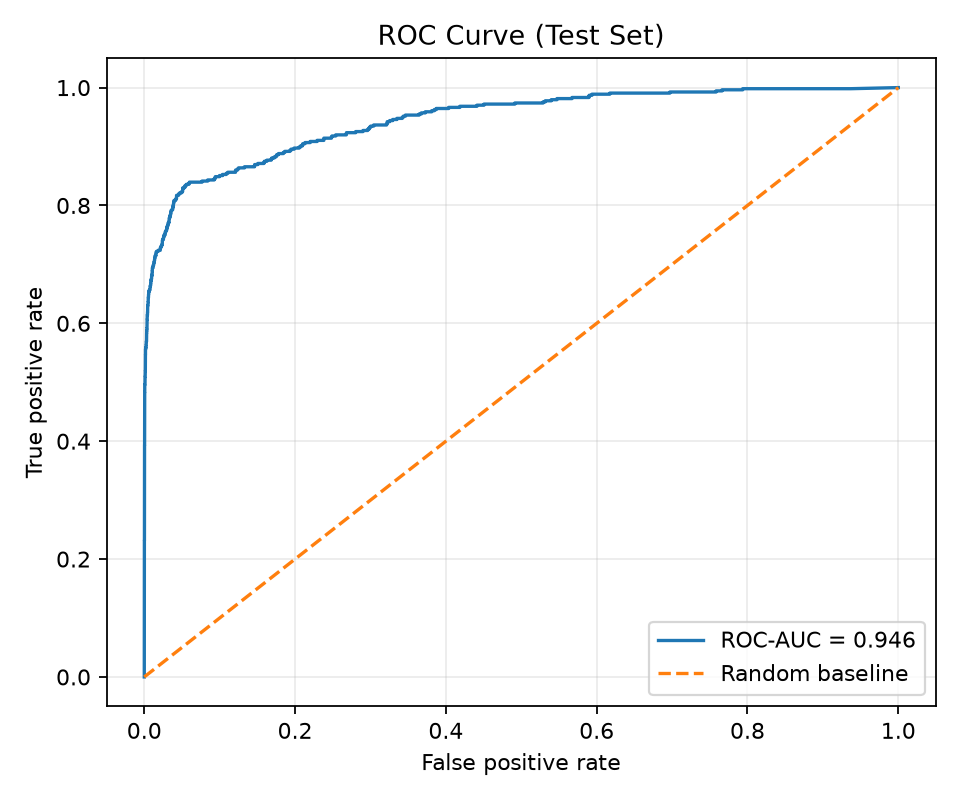
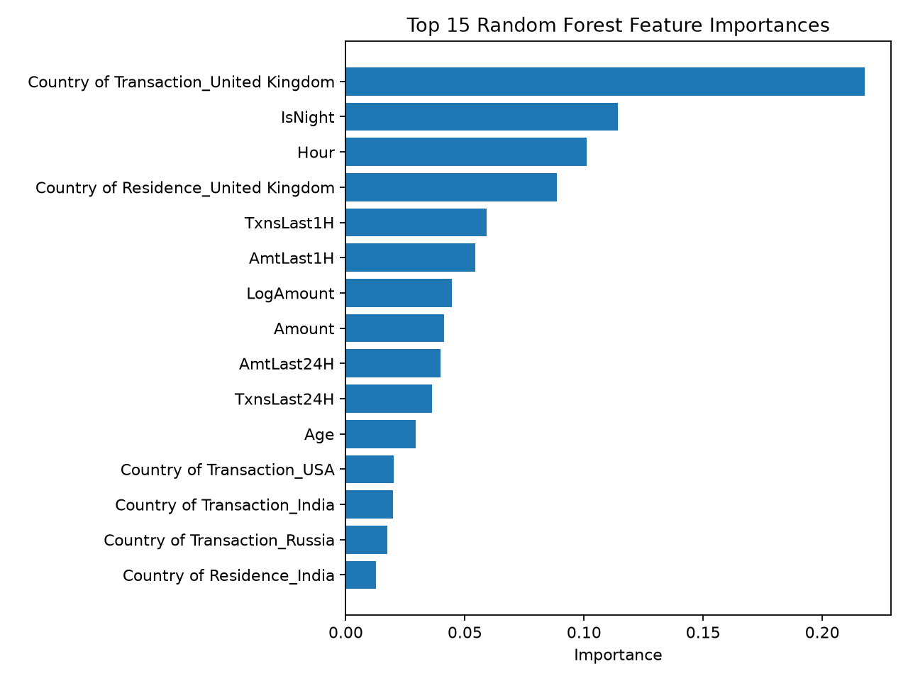

# Credit Card Fraud Detection

A machine learning-based project that detects potentially fraudulent credit card transactions using transaction attributes, temporal patterns, and historical transaction activity features.

The project implements a **Random Forest Classifier** with chronological data splitting, fraud-focused evaluation metrics, and validation-based probability threshold optimization.

## Project Objective

The objective is to identify potentially fraudulent transactions while minimizing false positives and maintaining strong fraud detection performance.

Since fraudulent transactions are relatively rare, the project evaluates the model using:

- Precision
- Recall
- F2-Score
- Average Precision (AP)
- ROC-AUC
- Confusion Matrix

## Dataset Description

The project uses three supplied datasets:

| Dataset | Records | Usage |
|---|---:|---|
| Transaction.csv | 100,000 | Used for model training and evaluation |
| Customer.csv | 10,127 | Additional dataset; not currently integrated |
| Call_history.csv | 101,174 | Additional dataset; not currently integrated |

**Note:** The current implementation uses only `Transaction.csv`. Customer and call-history records are not integrated because a verified transaction-to-customer mapping has not yet been established.

## Methodology

The project follows these steps:

1. **Data Preprocessing:** Load transaction records and clean transaction amounts and timestamps.
2. **Feature Engineering:** Extract hour, weekday, night-time indicators, and log-transformed transaction amounts.
3. **Temporal Features:** Generate trailing 1-hour and 24-hour transaction count and amount features using only earlier transactions.
4. **Categorical Encoding:** Fit categorical encoders using the training period only.
5. **Chronological Splitting:** Divide the dataset into 70% training, 15% validation, and 15% testing.
6. **Model Training:** Train a Random Forest classifier with balanced class weighting.
7. **Threshold Optimization:** Select the probability threshold by maximizing F2-score on the validation dataset.
8. **Model Evaluation:** Evaluate performance on the untouched chronological test dataset.
9. **Result Generation:** Save the trained model, predictions, metrics, and visualization graphs.

### Data Leakage Prevention

- The `Fraud` target variable is excluded from model input features.
- Chronological splitting is performed before fitting categorical encoders.
- Rolling transaction features use only past transactions.
- The validation dataset is used for threshold optimization.
- The final test dataset is reserved for independent evaluation.

## Model Configuration

| Parameter | Configuration |
|---|---|
| Algorithm | Random Forest Classifier |
| Class Weight | Balanced |
| Training Split | 70% |
| Validation Split | 15% |
| Testing Split | 15% |
| Input Features | 43 |
| Threshold Selection | Validation F2-score |
| Selected Threshold | 0.269280 |

## Model Performance

The model was evaluated on a chronological test dataset containing 14,999 transactions.

### Evaluation Metrics

| Metric | Default Threshold (0.50) | Tuned Threshold |
|---|---:|---:|
| Precision | 0.8458 | 0.5631 |
| Recall | 0.6138 | 0.7239 |
| F2-Score | 0.6494 | 0.6848 |

Additional test metrics:

| Metric | Result |
|---|---:|
| Average Precision | 0.7506 |
| ROC-AUC | 0.9455 |

The validation-selected threshold improves fraud recall and F2-score compared with the default threshold, while reducing precision. This demonstrates the trade-off between detecting more fraudulent transactions and generating additional false-positive alerts.

### Confusion Matrix

At the validation-selected threshold:

| Actual / Predicted | Legitimate | Fraud |
|---|---:|---:|
| Legitimate | 14,162 | 301 |
| Fraud | 148 | 388 |

## Results and Visualizations

The following graphs are generated during model training.

### 1. Confusion Matrix

Shows correctly and incorrectly classified legitimate and fraudulent transactions.



### 2. Precision-Recall Curve

Illustrates the trade-off between precision and recall across different classification thresholds.



### 3. ROC Curve

Shows the model's ability to distinguish fraudulent transactions from legitimate transactions.



### 4. Feature Importance

Displays the 15 most influential features according to the Random Forest model.



## Repository Structure

```text
credit-card-fraud-detection/
│
├── Transaction.csv
├── Customer.csv
├── Call_history.csv
├── notebook.ipynb
├── train_model.py
├── requirements.txt
├── README.md
├── .gitignore
│
└── outputs/
    ├── confusion_matrix.png
    ├── precision_recall_curve.png
    ├── roc_curve.png
    ├── feature_importance.png
    ├── feature_importance.csv
    ├── metrics.json
    ├── fraud_model.joblib
    └── fraud_predictions.csv
```

**Note:** The `outputs/` directory is generated when the training script runs. Large model and prediction files may be excluded from GitHub through `.gitignore`.

## Installation and Setup

### Prerequisites

- Python 3.10 or newer
- pip
- Git

### 1. Clone the Repository

```bash
git clone https://github.com/Debalina27/credit-card-fraud-detection.git

cd credit-card-fraud-detection
```

### 2. Create a Virtual Environment

```bash
python -m venv .venv
```

### 3. Activate the Environment

**Windows:**

```bash
.venv\Scripts\activate
```

**Linux/macOS:**

```bash
source .venv/bin/activate
```

### 4. Install Dependencies

```bash
pip install -r requirements.txt
```

## Run the Project

Ensure that `Transaction.csv` is available in the project root directory.

Execute:

```bash
python train_model.py
```

After successful execution, the script generates the `outputs/` directory containing:

- `fraud_model.joblib` – Trained Random Forest model and associated configuration.
- `fraud_predictions.csv` – Test-set predictions and probabilities.
- `metrics.json` – Model evaluation metrics.
- `confusion_matrix.png` – Confusion matrix visualization.
- `precision_recall_curve.png` – Precision-recall visualization.
- `roc_curve.png` – ROC visualization.
- `feature_importance.png` – Feature importance visualization.
- `feature_importance.csv` – Feature importance values.

## Technologies Used

- **Programming Language:** Python
- **Data Processing:** Pandas, NumPy
- **Machine Learning:** Scikit-learn
- **Algorithm:** Random Forest
- **Data Visualization:** Matplotlib
- **Model Serialization:** Joblib
- **Development Environment:** Jupyter Notebook, VS Code

## Limitations and Future Improvements

### Current Limitations

- Customer and call-history datasets are not yet integrated.
- The project is an experimental academic baseline, not a production payment-fraud prevention system.
- Threshold optimization involves a trade-off between precision and recall.
- Further validation across different time periods is required.
- Random Forest feature importance indicates model reliance, not causal relationships.

### Future Improvements

- Integrate customer and call-history data using a verified mapping.
- Compare Random Forest with XGBoost and other classification algorithms.
- Explore explainable AI techniques such as SHAP.
- Develop a real-time fraud prediction API.
- Build an interactive fraud monitoring dashboard.
- Evaluate model performance under changing transaction patterns.

## License

No license is currently specified. A license can be added if the project is intended for public reuse.

---

**Author:** Debalina Das

**GitHub:** https://github.com/Debalina27/credit-card-fraud-detection
